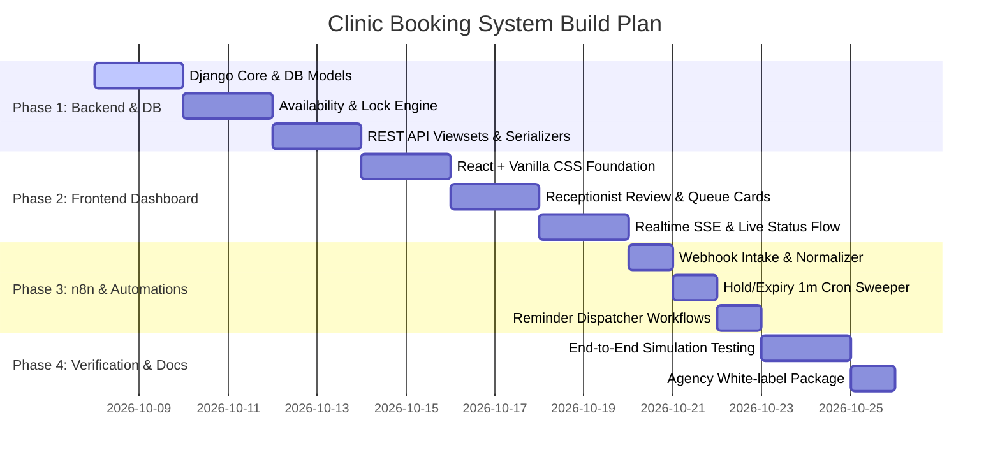

# Build Plan & Implementation Milestones

## 1. Phased Development Roadmap

---

## 2. Milestone Deliverables
- **Milestone 1 (Backend Core & Security)**: Fully functional Django backend with SQLite/MySQL models, migrations, deterministic availability calculator, and **Staff Governance & Instant Deactivation API** (with immediate JWT session revocation upon admin toggle).
- **Milestone 2 (Receptionist & Admin Dashboard)**: Modern React + Vanilla CSS dashboard inspired by clinical aesthetic reference (`pinterest_ref`), featuring active request queue, slot editing modal, countdown badges, live visit transitions, and **Staff Management Panel** (Create staff, Reset PIN, 1-Click Deactivate/Revoke).
- **Milestone 3 (n8n Automations)**: Exportable n8n workflows for WhatsApp webhooks, 1-minute expiration cron, and 24h reminders.
- **Milestone 4 (Interactive Web Widget & Agency Package)**: Patient booking widget and ready-to-deploy white-label agency distribution.
