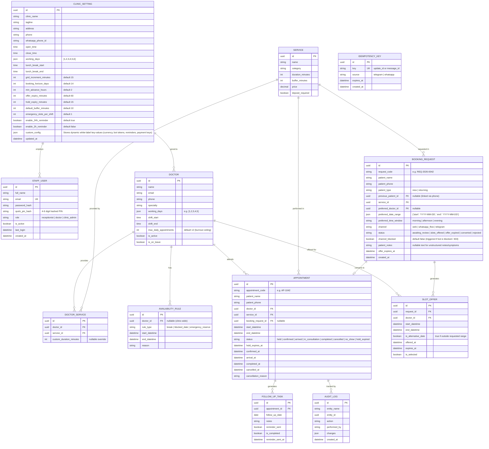

# Database Schema Specification & Data Dictionary

## 1. Entity-Relationship Model (ERD)

---

## 2. Table Indexing & Performance Strategy
- `idx_appointment_doctor_time`: `(doctor_id, start_datetime, end_datetime)` for sub-millisecond overlap queries.
- `idx_request_status_expiry`: `(status, offer_expires_at)` for fast 60s expiry cron sweepers.
- `idx_appointment_status_hold`: `(status, hold_expires_at)` for fast hold expiry sweeper.
