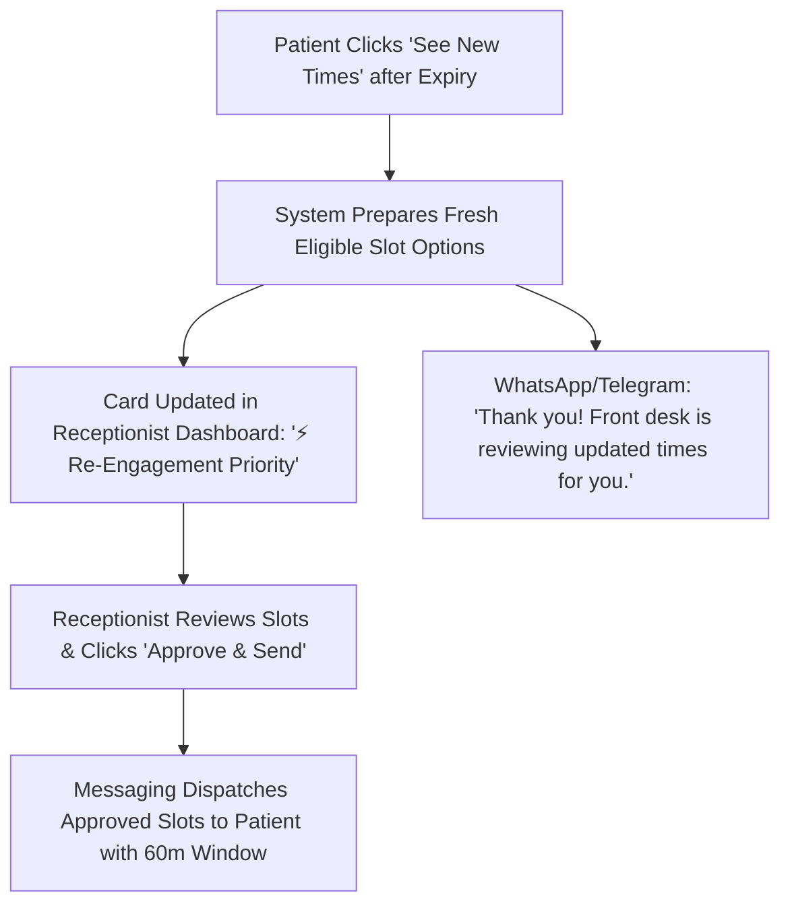

# Edge Cases & Exception Handling Matrix

## 1. Deep Dive: Receptionist Away from Desk During Re-Engagement

### The Scenario
1. Patient receives 3 approved slot options (60-minute offer window).
2. Patient does not respond within 60 minutes; the offer transitions to `offer_expired`.
3. An automated recovery message is sent with `[🔄 See New Times]`.
4. Patient clicks `[🔄 See New Times]`, expecting immediate slot choices.
5. **Conflict**: If the system waits for receptionist manual approval again, but the receptionist is away from desk, attending to a walk-in, or it's after hours, the patient gets stuck in limbo and may abandon the clinic.

---

### The Strict Principle: 100% Receptionist Gatekeeping
At all costs, **the receptionist must review and approve every single slot offered to a patient**. There is **no automatic slot dispatching** by the system or AI. The receptionist remains the central human operator who maintains complete visibility and authority over who receives what time slot.

---

### How Expired Slot Re-Engagement Operates Under Strict Human Approval

1. **Instant Patient Acknowledgment**: When the patient clicks `[🔄 See New Times]`, WhatsApp/Telegram instantly replies:
   > *"Thank you, Amina. We have notified our front desk. The receptionist is reviewing updated times for your Dental Consultation and will send you fresh options shortly."*
   *(This ensures the patient is never left hanging or wondering if the button worked).*
2. **Dashboard Queue Elevation**: The request immediately jumps to the top of the receptionist's dashboard flagged as **"⚡ Re-Engagement Priority (Waiting)"** with a subtle audio alert.
3. **Receptionist Approval**: The dashboard presents the freshly calculated candidate slots. The receptionist inspects them, adjusts if necessary, and clicks **`[Approve & Dispatch Options]`**.
4. **Offer Delivery**: Only upon receptionist action does the patient receive the 3 options with the new 60-minute offer window.

---

## 2. Complete Edge Case & Failure Mode Matrix

| Edge Case / Scenario | Root Cause | System Behavior & Fallback | Patient Experience |
| :--- | :--- | :--- | :--- |
| **Simultaneous Slot Selection (Race Condition)** | Two patients receive overlapping slot offers and click confirm at the exact same second. | Database uses `SELECT FOR UPDATE` inside a Django atomic transaction. Patient A acquires the 15-minute `held` lock. Patient B's transaction fails safely. | Patient B receives: *"Just missed it! That slot was just reserved. Here are 2 alternative times on the same day..."* |
| **Two Receptionists Review Same Card Simultaneously** | Receptionist Sarah and Receptionist Mary both click the same patient card at 10:00 AM on separate screens. | • **Presence Badge**: When Sarah opens the card, Mary’s screen displays `👀 Sarah is reviewing`. • **Atomic Lock**: If both click `[Approve]`, only the first transaction commits; the second receives a clean notice: *"Already dispatched by Sarah"*. | Patient receives only ONE message with approved slots, eliminating duplicate messages. |
| **Patient Requests Doctor Not on Shift** | Patient types natural language request for a doctor on their off-day. | Extraction engine tags date mismatch; Availability engine filters eligible dates; Receptionist review card highlights doctor availability in amber. | Receptionist offers alternative dates when that doctor is on duty or suggests another available doctor. |
| **Late Response to Expired Slot (Manual Text)** | Patient replies *"1"* 75 minutes later (after 60-minute expiration). | System detects `offer_expired` status. Validates if slot is still free. If free → restores hold. If occupied → sends fresh times. | Smooth continuity without telling the patient they "failed". |
| **Patient Cancels at Short Notice (< 2 Hours)** | Patient replies `[Cancel]` 1 hour before appointment. | Status updates to `cancelled`. Slot is immediately marked available. Waitlist or walk-in queue is notified on dashboard. | Polite cancellation confirmation + easy 1-click reschedule link. |
| **Network / Webhook Timeout from WhatsApp** | WhatsApp API temporary outage or delivery failure. | n8n retries webhook with exponential backoff (3 attempts). Failed deliveries logged in audit table. | Fallback to SMS notification if configured. |
| **No-Show Tracking vs Silent Patients** | Appointment time passes without receptionist marking `Arrived`. | System flags appointment as `no_show` only after end of day audit, not during active hours. | Follow-up welfare message sent: *"We missed you today. Hope everything is alright! Click here to rebook."* |
