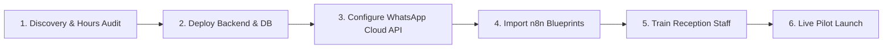

# Agency Game Plan & Operational Strategy

## 1. Value Proposition for Clinic Clients
1. **Zero Double-Bookings**: Guaranteed through atomic database holds and receptionist validation.
2. **Reduced No-Shows**: 24-hour and 2-hour WhatsApp interactive confirmations allow patients to confirm or reschedule instantly.
3. **Staff Relief**: Reduces 80% of repetitive phone calls and WhatsApp chats by presenting ready-to-approve slot packages.
4. **Fast 1-Day Client Onboarding**: White-label template config allows seeding a clinic's doctors, services, and opening hours in under 30 minutes.

---

## 2. Client Rollout & Onboarding Checklist

| Phase | Duration | Deliverables |
| :--- | :--- | :--- |
| **Phase 1: Setup** | Day 1 | Populate `client-config.json`, run database migrations, seed doctors & services. |
| **Phase 2: Channels** | Day 2 | Connect WhatsApp Cloud API number, verify webhook URLs, embed Web Booking widget on client site. |
| **Phase 3: Staff Prep** | Day 3 | 45-minute receptionist training session on the dashboard workflow. |
| **Phase 4: Pilot & Measure**| Weeks 1–2 | Monitor request conversion rate, offer expiry recovery rate, and attendance metrics. |
