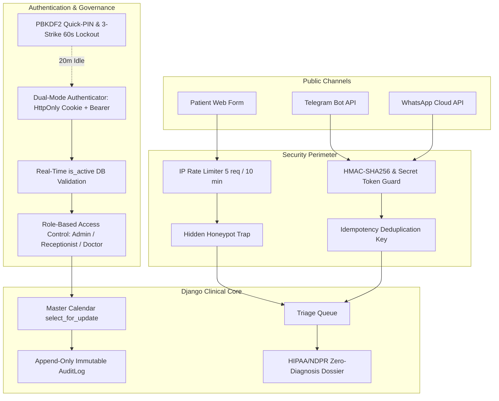
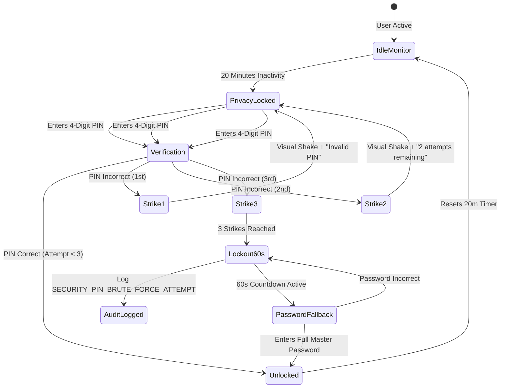

# Security Architecture & Authentication Specification

## 1. Executive Summary & Clinical Threat Model
This document codifies the end-to-end security, authentication, and regulatory privacy architecture for the **Receptionist-Approved Clinic Booking System** agency template.

In an active medical clinic environment, the threat landscape encompasses both **cybersecurity vulnerabilities** (e.g., token theft, webhook replay attacks, brute-force PIN attacks) and **physical operational risks** (e.g., walk-away workstation exposure, shift handover confusion, medical diagnosis leakage on reception screens).



---

## 2. Authentication Architecture: Dual-Mode JWT & Session Governance

### 2.1 Dual-Mode Token Transport (HttpOnly Cookies + Bearer Header)
To balance state-of-the-art browser security against flexible API integration, the backend implements a **Dual-Mode Authentication Mechanism** via a custom Django REST Framework authentication class: `CookieJWTAuthentication`.

| Client Type | Transport Mechanism | Storage Location | Protection Profile |
| :--- | :--- | :--- | :--- |
| **Receptionist Web Dashboard (React)** | `HttpOnly`, `Secure`, `SameSite=Lax` Cookie | Browser Cookie Jar | **Immune to XSS token theft**. JavaScript cannot access `document.cookie` to steal the JWT. |
| **External API / Mobile / n8n Automation** | `Authorization: Bearer <token>` Header | Client Memory / Secrets Manager | Standard headless REST authorization for automated workflows. |

### 2.2 Token Lifecycle & Rotation
- **Access Token Lifetime**: 60 minutes (`SIMPLE_JWT['ACCESS_TOKEN_LIFETIME'] = timedelta(minutes=60)`).
- **Refresh Token Lifetime**: 30 days (`SIMPLE_JWT['REFRESH_TOKEN_LIFETIME'] = timedelta(days=30)`).
  - Enables receptionists to remain logged into their workstation across daily clinic shifts without daily password friction.
- **Token Rotation**: `ROTATE_REFRESH_TOKENS = True`. Each refresh issues a new refresh token and invalidates the previous one.

### 2.3 Real-Time `is_active` Database Validation (Instant Session Revocation)
Standard JWT implementations suffer from the vulnerability that tokens remain cryptographically valid until expiry, even if a user account is suspended.

In this system:
1. Every authenticated API request inspects `StaffUser.is_active` via the custom `CookieJWTAuthentication` backend.
2. If an administrator clicks `[1-Click Deactivate]` on a staff member:
   - The user record is updated to `is_active = False`.
   - The very next request made by that user's browser immediately receives a `401 Unauthorized` with error payload:
     ```json
     {
       "error": "ACCOUNT_DEACTIVATED",
       "detail": "Your staff account has been deactivated by administration. Session terminated."
     }
     ```
   - The response clears all authentication cookies (`Max-Age=0`) and the React frontend automatically redirects to `/login`.

---

## 3. Workstation Privacy: 20-Minute Idle Lock & Quick-PIN Architecture

### 3.1 The Front-Desk Physical Exposure Risk
In a busy clinic, receptionists frequently step away to guide patients to examination rooms, collect medical records, or assist doctors. An unattended monitor displaying patient names, phone numbers, and visit times violates medical privacy regulations.

### 3.2 Dual-Layer Privacy Lock Flow
1. **Idle Activity Monitor (`usePinLock.js`)**:
   - Listens to user interactions (`mousemove`, `mousedown`, `keydown`, `touchstart`).
   - If no interaction occurs for **20 consecutive minutes**, the dashboard enters `LOCKED` state.
   - The viewport renders `PrivacyLockModal.jsx` with an aggressive frosted glass backdrop (`backdrop-filter: blur(18px); background: rgba(15, 15, 15, 0.88)`), completely obscuring underlying schedule data.
2. **Fast 4-Digit Quick-PIN Unlock**:
   - The receptionist types their 4-digit PIN (e.g., `1234`) via on-screen numpad or physical keyboard.
   - Request dispatched to `POST /api/v1/auth/pin-unlock/` with `{ "pin": "1234" }`.
   - The backend validates the PIN against the user's salted PBKDF2 hash (`StaffUser.quick_pin_hash`).
   - Upon success: Modal unblurs in <100ms, resetting the 20-minute timer.

### 3.3 3-Strike Brute-Force Shield & Escalation Protocol
To prevent unauthorized staff, cleaners, or patients from guessing the 4-digit PIN:



- **Strike 1 & 2**: Immediate visual shake animation on the 4 PIN dots with feedback text: *"Incorrect PIN. 2 attempts remaining."*
- **Strike 3 (Lockout)**:
  1. The numpad is disabled and locked for **60 seconds** with an active countdown timer.
  2. The interface switches to **Master Password Fallback**: The user cannot use PIN and must enter their full account password to unlock.
  3. A high-priority security event is appended to `AuditLog`:
     ```json
     {
       "entity_name": "StaffUser",
       "entity_id": "9b1deb4d-3b7d-4bad-9bdd-2b0d7b3dcb6d",
       "action": "SECURITY_PIN_LOCKOUT_TRIGGERED",
       "performed_by": "sarah@clinic.com",
       "changes": {
         "reason": "3 consecutive invalid PIN entries",
         "lockout_seconds": 60,
         "ip_address": "192.168.1.42"
       }
     }
     ```

---

## 4. Role-Based Access Control (RBAC) Governance

Access permissions are enforced strictly at both the Django REST Framework view layer (`permissions.py`) and the React navigation layer (`LeftRail.jsx`).

| Feature / Endpoint | Clinic Admin | Receptionist | Doctor | Public / Anonymous |
| :--- | :---: | :---: | :---: | :---: |
| **Inbound Queue Triage (`/queue`)** | Full Access | Full Access | View Only | Blocked (401) |
| **Candidate Slot Dispatch (1-Hour Offer)** | Full Access | Full Access | Blocked (403) | Blocked (401) |
| **Master Clinical Calendar (`/calendar`)** | Full Access | Full Access | Own Schedule | Blocked (401) |
| **Manual Calendar Booking & Holds** | Full Access | Full Access | Blocked (403) | Blocked (401) |
| **Live Visits Swimlanes (`/live-visits`)** | Full Access | Full Access | Consultation Only | Blocked (401) |
| **Doctor-Directed Follow-Up Recall** | Full Access | Full Access | Full Access | Blocked (401) |
| **Walk-In Emergency Override (R-11)** | Full Access | Full Access | Blocked (403) | Blocked (401) |
| **Doctor Duty Toggle (`on_duty`/`on_break`)**| Full Access | Full Access | Own Status | Blocked (401) |
| **Doctor Sick Leave Protocol (R-15)** | Full Access | Full Access | Blocked (403) | Blocked (401) |
| **Staff Directory & Roster (`/admin/staff`)**| Full Access | View Roster Only | View Roster Only | Blocked (401) |
| **Staff Account Creation & PIN Reset** | Full Access | Blocked (403) | Blocked (403) | Blocked (401) |
| **1-Click Staff Deactivation** | Full Access | Blocked (403) | Blocked (403) | Blocked (401) |
| **Clinic Operating Settings (`/admin/settings`)**| Full Access | Blocked (403) | Blocked (403) | Blocked (401) |
| **CSV Financial & Attendance Export** | Full Access | Blocked (403) | Blocked (403) | Blocked (401) |
| **System Audit Logs (`AuditLog`)** | View Only | Blocked (403) | Blocked (403) | Blocked (401) |
| **Public Booking Form Intake** | Blocked | Blocked | Blocked | **Allowed (Rate-Limited)** |

---

## 5. Regulatory Medical Privacy: HIPAA & NDPR Compliance

### 5.1 Zero-Diagnosis Exposure Principle
Under Nigerian Data Protection Regulation (NDPR) and international healthcare compliance (HIPAA), administrative staff should not have unnecessary exposure to sensitive diagnostic medical records.

1. **Returning Patient Phone Recognition**:
   - When a patient phone number matches an existing record in the database, the front-desk modal displays:
     - Patient Full Name: `Amina Yusuf`
     - Attendance Reliability Score: `🟢 100% Reliable (4 attended, 0 no-shows)`
     - Last Visit Date: `October 2, 2026`
     - Service Rendered: `Dental Consultation`
   - **Zero Medical Notes Exposed**: Detailed surgical findings, lab results, and confidential clinical notes taken by the doctor are strictly shielded from the receptionist queue view.
2. **Log Sanitization & Phone Masking**:
   - All server standard output, debug messages, and application logs mask phone numbers:
     - Raw E.164: `+2348031234567`
     - Output Log: `+234 803 *** **67`
3. **Immutable Append-Only Audit Logging**:
   - The `AuditLog` table records:
     - Timestamp (UTC)
     - Performing Actor (Staff Email / System ID)
     - Action (e.g. `OFFER_DISPATCHED`, `STATUS_CHANGED`, `HOLD_OVERRIDDEN`)
     - Target Entity (`BookingRequest`, `Appointment`, `StaffUser`)
     - JSON Diffs (`before` vs `after` state)
     - Client IP Address
   - The `AuditLog` model has NO `UPDATE` or `DELETE` endpoints exposed in the API. It is strictly append-only.

---

## 6. Public Booking Widget Protection: Anti-Spam & DoS Defense

Public-facing intake forms are vulnerable to bot flooding, automated script injection, and fake appointment denial-of-service attacks.

### 6.1 Invisible Honeypot Field (`clinic_web_trap`)
- The patient booking form in React contains an invisible input field styled with `display: none !important; opacity: 0; position: absolute; left: -9999px;` and `tabIndex = -1`:
  ```html
  <input type="text" name="clinic_web_trap" autoComplete="off" />
  ```
- Legitimate human patients never interact with or fill this field.
- Automated bots and web scrapers populate all available inputs.
- If the backend receives a payload where `clinic_web_trap` is non-empty:
  - The request is immediately rejected.
  - To prevent bot authors from discovering the trap, the backend returns a fake `201 Created` HTTP response without writing any data to the database.

### 6.2 IP-Based Rate Limiting
- Public intake endpoint: `POST /api/v1/booking-requests/`.
- Configured with Django REST Framework custom throttling: `5 requests per 10 minutes per IP address`.
- Legitimate patients never book more than 1–2 appointments in a 10-minute window.
- Exceeding the rate limit returns `429 Too Many Requests` with a clear retry header:
  ```json
  {
    "error": "RATE_LIMIT_EXCEEDED",
    "detail": "Too many booking requests from this network. Please wait 10 minutes before submitting again."
  }
  ```

---

## 7. Webhook Security & Messaging Integrity

External messaging gateways (Telegram Bot API and WhatsApp Cloud API) transmit patient responses, inline button clicks, and cancellations.

### 7.1 Telegram Webhook Secret Token Verification
- When configuring the Telegram webhook via `setWebhook`:
  $$\text{Secret Token} = \text{SHA256}(\text{CLINIC\_TELEGRAM\_BOT\_TOKEN} + \text{DJANGO\_SECRET\_KEY})$$
- Telegram passes this token in the HTTP header: `X-Telegram-Bot-Api-Secret-Token`.
- The Django webhook receiver verifies this header before parsing the payload. If missing or mismatched:
  - Returns `401 Unauthorized` immediately.

### 7.2 WhatsApp Cloud API HMAC-SHA256 Signature
- Meta Cloud API signs all webhook payloads with the App Secret.
- The webhook receiver validates the `X-Hub-Signature-256` header:
  $$\text{Expected Signature} = \text{HMAC-SHA256}(\text{request.raw\_body}, \text{META\_APP\_SECRET})$$
- If cryptographic verification fails, the payload is rejected with `403 Forbidden`.

### 7.3 Webhook Idempotency & Replay Attack Defense
- Messaging platforms frequently retry webhook deliveries if latency exceeds 2–5 seconds.
- Every incoming message contains a unique gateway identifier:
  - Telegram: `update_id`
  - WhatsApp: `entry[0].changes[0].value.messages[0].id`
- The backend checks `IdempotencyKey`:
  ```python
  key_string = f"{source}:{external_id}"
  created = IdempotencyKey.objects.get_or_create(
      key=key_string,
      defaults={'source': source, 'expires_at': timezone.now() + timedelta(hours=24)}
  )
  if not created:
      # Duplicate webhook delivery detected; acknowledge with 200 OK without re-executing logic
      return Response({"status": "duplicate_ignored"}, status=status.HTTP_200_OK)
  ```
- Guarantees zero duplicate slot holds or redundant confirmation messages.

---

## 8. Concurrency Security: The Single Atomic Funnel

To eliminate race conditions between online bot selections, web widget holds, and receptionist counter bookings:

```python
@transaction.atomic
def acquire_slot_hold(doctor_id, start_datetime, end_datetime, patient_name, patient_phone, booking_request=None):
    """
    Acquires an atomic hold on a clinical slot with row-level locking.
    Guarantees absolute immunity against double-booking.
    """
    # 1. Lock doctor row to serialize concurrent booking evaluations
    doctor = Doctor.objects.select_for_update().get(id=doctor_id)
    
    # 2. Lazy self-healing: purge any expired holds within this time block
    Appointment.objects.filter(
        doctor=doctor,
        status='held',
        hold_expires_at__lt=timezone.now()
    ).update(status='hold_expired')
    
    # 3. Check for conflicting confirmed appointments or active holds
    conflict = Appointment.objects.filter(
        doctor=doctor,
        status__in=['confirmed', 'held', 'arrived', 'in_consultation'],
        start_datetime__lt=end_datetime,
        end_datetime__gt=start_datetime
    ).exists()
    
    if conflict:
        raise SlotConflictException("This slot was just secured by another patient or reception.")
        
    # 4. Create atomic hold
    hold = Appointment.objects.create(
        doctor=doctor,
        service=service,
        patient_name=patient_name,
        patient_phone=patient_phone,
        booking_request=booking_request,
        start_datetime=start_datetime,
        end_datetime=end_datetime,
        status='held',
        hold_expires_at=timezone.now() + timedelta(minutes=15)
    )
    return hold
```

---

## 9. Next Steps & Backend Integration
This Security Architecture will be incrementally built into the codebase across:
1. **Phase 2 (Services)**:
   - `availability.py`: Buffer sanitization rules and emergency slot shielding.
   - `hold_service.py`: Concurrency-safe atomic transaction funnel.
2. **Phase 3 (APIs & Auth)**:
   - `CookieJWTAuthentication`: HttpOnly cookie authentication and real-time `is_active` validation.
   - `pin_unlock` endpoint with 3-strike brute-force throttling and audit logging.
   - Inbound webhook receivers with HMAC signature verification and `IdempotencyKey` deduplication.
