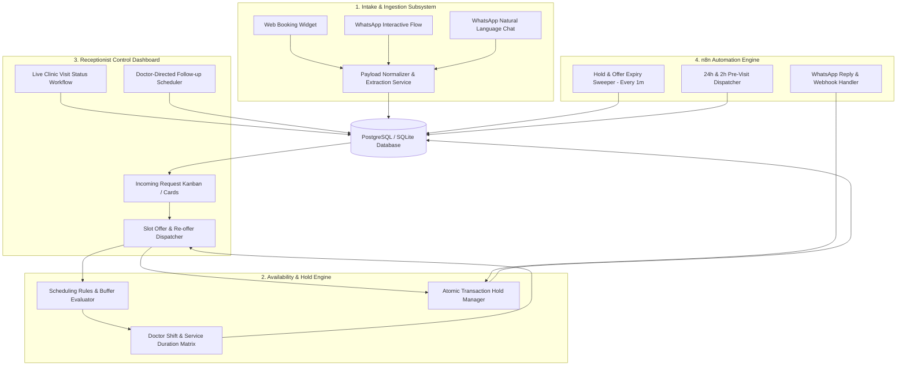

# System Design & Core Architectural Decisions

## 1. Executive Summary
The **Clinic Booking System** is an agency-grade, human-in-the-loop healthcare booking platform.
It reconciles the flexibility of omnichannel patient communication (Web + WhatsApp) with the operational rigor of receptionist approval and deterministic database-level slot locks.

---

## 2. Core Subsystems

---

## 3. Key Architectural Decisions (ADRs)

### ADR-01: Deterministic Engine vs AI Scheduling
- **Decision**: AI / LLM is strictly restricted to text normalization and extraction. Slot generation, overlap checking, working hours calculation, and locks are 100% computed by Python/Django rule algorithms.
- **Rationale**: Eliminates hallucinations, overlapping double-bookings, and invalid medical appointments.

### ADR-02: Two-Phase Slot Lock Lifecycle (`Offered` vs `Held` vs `Confirmed`)
- **No-Deposit Services (Standard)**: Patient selects a slot $\rightarrow$ system acquires atomic lock $\rightarrow$ transitions immediately to `confirmed` $\rightarrow$ patient receives instant WhatsApp confirmation card with Reference # (`AP-1042`).
- **Deposit-Required Services (High-Value Procedures)**: Patient selects slot $\rightarrow$ transitions to `held` (15-30m window) $\rightarrow$ patient receives payment link & bank instructions $\rightarrow$ receptionist sees amber `Held — Awaiting Deposit` badge with live countdown $\rightarrow$ once payment is verified, status flips to green `confirmed`.

### ADR-04: Staff Authentication, Multi-Receptionist Shared Operations & Session Expiry
- **Concurrent Multi-Receptionist Front Desk**: Medium and large clinics frequently have 2 or 3 receptionists working simultaneously on different desks/screens. The system fully supports multiple concurrent active receptionist accounts:
  - **Shared Live State**: All active receptionists see the same incoming requests, doctor calendar, and patient statuses synced in real time via SSE.
  - **Card Collision Prevention ("Being Reviewed" Presence)**: When Receptionist Sarah opens a request card to check slots, the card on Receptionist Mary's screen displays a subtle badge: `👀 Sarah is reviewing`.
  - **Atomic Approval Lock**: If two receptionists click approve at the exact same split-second, database transaction isolation guarantees only the first action commits, while the second screen smoothly updates with *"Already dispatched by Sarah"*.
  - **Independent User Audit**: Every action distinctly logs the specific logged-in receptionist's ID, name, and IP address for full operational accountability.
- **Two-Tier Session Security**:
  - **Tier 1 (20-Minute Quick PIN Lock)**: After 20 minutes of inactivity, the screen locks with a 4-digit PIN pad. This allows rapid desk unlocking (< 3 seconds) while safeguarding patient health data from waiting-room visitors.
  - **Tier 2 (30-Day Session Lifetime)**: Receptionist sessions remain active for **30 days** via secure HTTP-Only refresh tokens. Staff do not have to type full email/passwords every morning; they simply enter their daily PIN.
  - **Manual Logout & Shift Switch**: Receptionists can click `[Switch User / Log Out]` at any moment to immediately terminate the session for the next shift receptionist. If a PIN is forgotten, the Clinic Admin can 1-click reset it.

### ADR-04: Stateless Frontend with Real-Time Event Sync
- **Decision**: React frontend communicates with Django via REST API + WebSocket / SSE polling for instantaneous card status updates.
